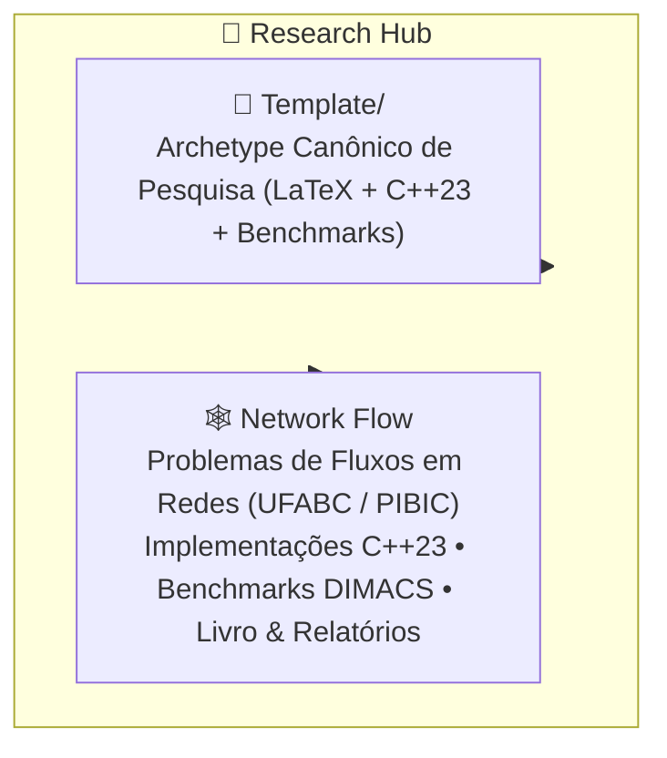

# 🔬 Research Hub

> **Orquestrador Federado de Pesquisa Científica & Otimização Combinatória**<br />
> _O laboratório de investigação acadêmica e matemática aplicada de Gabriel Frigo (UFABC / PIBIC)._

<div align="center">

[](LICENSE)
[](Network%20Flow/)
[](https://www.latex-project.org/)
[](http://dimacs.rutgers.edu/)
[](https://github.com/GabrielFrigo4/research/actions/workflows/ci.yml)
[](https://github.com/GabrielFrigo4/research/releases/latest)

</div>

---

## 📖 Visão Geral

O repositório **Research** centraliza os projetos de pesquisa científica, publicações acadêmicas em LaTeX e implementações computacionais rigorosas na interseção entre Ciência da Computação, Teoria dos Grafos e Otimização Combinatória:



---

## 🧩 Os Componentes do Research

| Componente                            | Foco & Responsabilidade                                                              | Tecnologias Centrais             | Origem / Remoto                                                               |
| :------------------------------------ | :----------------------------------------------------------------------------------- | :------------------------------- | :---------------------------------------------------------------------------- |
| [**`Template/`**](Template/)          | Archetype canônico para criar novos repositórios de pesquisa com interface unificada | C++23, LaTeX, POSIX Make         | Diretório versionado no Hub                                                   |
| [**`Network Flow`**](Network%20Flow/) | Teoria, algoritmos (Max Flow & Min-Cost Flow), experimentos e monografia LaTeX       | C++23, LaTeX, DIMACS, POSIX Make | [`GabrielFrigo4/network-flow`](https://github.com/GabrielFrigo4/network-flow) |

---

## 📚 Biblioteca Federada de Livros (CI/CD Releases)

O pipeline do Hub descobre automaticamente todos os submódulos de pesquisa que implementam o contrato canônico (`Makefile` com alvo `make book` gerando `latex/book.pdf`, ignorando `Template/` e artefatos congelados de IC) e publica exclusivamente os **Livros Monográficos** na página de [Releases do Research](https://github.com/GabrielFrigo4/research/releases/latest):

- 📗 [`network-flow-book.pdf`](https://github.com/GabrielFrigo4/research/releases/latest/download/network-flow-book.pdf) — _Problemas de Fluxos em Redes_ ([`Network Flow/`](Network%20Flow/))

---

## 🧬 Como Criar uma Nova Pesquisa (via `Template/`)

1. Copie o diretório [`Template/`](Template/) para a nova pasta do projeto (ex.: `Algoritmos Probabilísticos`).
2. Execute o inicializador para substituir placeholders, configurar hooks e iniciar o repositório Git:
    ```sh
    ./init.sh --rm
    ```
3. Publique o novo repositório no GitHub e registre-o como submódulo no Hub (`git submodule add`). O contrato `make book` integrará automaticamente o novo livro às [Releases do Research](https://github.com/GabrielFrigo4/research/releases/latest).

---

## 🚀 Como Obter e Operar

Clonagem recursiva:

```sh
git clone --recursive "https://github.com/GabrielFrigo4/research.git"
cd research
```

Ou clonagem simples seguida de bootstrap:

```sh
git clone "https://github.com/GabrielFrigo4/research.git"
cd research
make clone
```

### Operações com o Makefile

| Comando            | Descrição                                                   |
| :----------------- | :---------------------------------------------------------- |
| `make status`      | Verifica estado de sincronização dos submódulos             |
| `make pull`        | Atualiza com as branches principais remotas                 |
| `make books`       | Compila todos os livros de pesquisa ativos em `dist/`       |
| `make build-latex` | Contrato de CI para compilar os livros federados em `dist/` |
| `make test`        | Executa validações e testes de integridade                  |
| `make ci`          | Executa a pipeline local completa de qualidade              |

---

## 📜 Governança e Princípios

- **Princípios de Engenharia:** Consulte [PRINCIPLES.md](PRINCIPLES.md) para os 22 princípios canônicos aplicados.
- **AI Agent Briefing:** Instruções de operação para agentes autônomos em [AGENTS.md](AGENTS.md).
